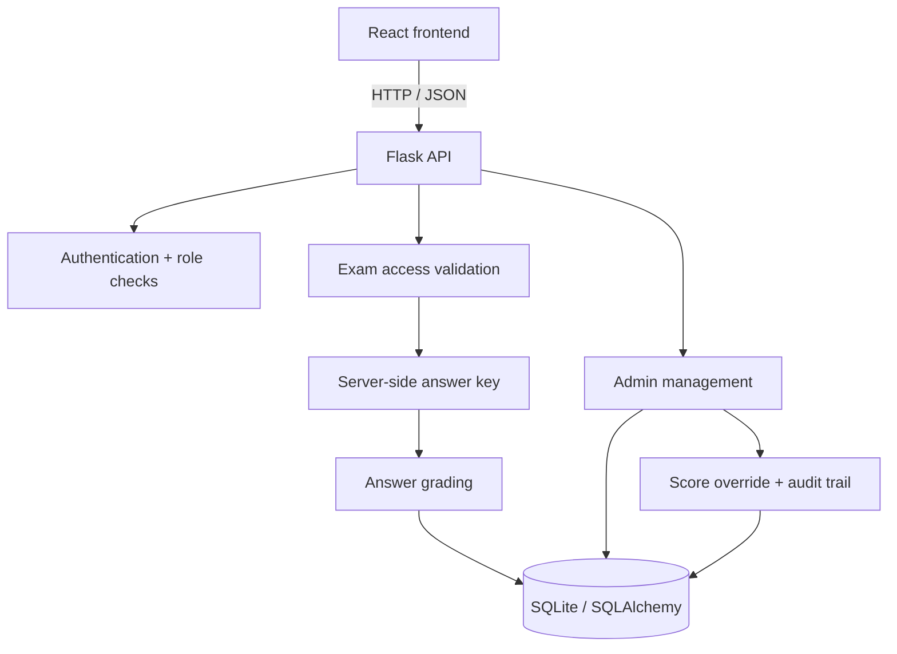

# Mathogic Mock Test

A full-stack mock-test platform with a React frontend and Flask API. Students register, wait for administrator approval, and take only the tests assigned to their accounts. Administrators manage student access, review submissions, inspect question reports, and apply auditable score adjustments.

## Features

### Student experience
- Register and sign in using an email and password.
- Wait for an administrator to activate the account and assign test access.
- View available tests and previous attempts.
- Complete timed practice tests in general knowledge, verbal reasoning, and logical aptitude.
- Review submitted results and report a question issue.

### Administrator experience
- Bootstrap an initial administrator from environment variables on first database initialization.
- Approve, suspend, or return student accounts to pending status.
- Grant or remove access to individual tests.
- Review student attempts, answers, and question reports.
- Override a final score only with a required reason.
- Preserve the automatic score and keep a history of manual score adjustments.

## Architecture



The frontend is a React single-page application served during development by Vite. The Flask API owns authentication, test-access enforcement, answer keys, grading, persisted attempts, reports, and administrator actions.

## Tech Stack

| Layer | Technology |
|---|---|
| Frontend | React 19, React DOM, React Router 7 |
| Build tooling | Vite 7 |
| Styling | Tailwind CSS 4 |
| Backend | Python, Flask |
| API integration | Flask-CORS |
| ORM / database | Flask-SQLAlchemy, SQLite by default |
| Authentication | Werkzeug password hashing, signed Flask sessions |
| Security controls | CSRF token validation, role-based authorization, HTTP-only session cookies |
| Testing / quality | Python unittest, ESLint, Vite build |

## Student and administrator workflow

1. A student creates an account through the account interface.
2. The backend stores the password hash and creates the account with a pending status.
3. An administrator signs in and activates the student.
4. The administrator assigns one or more available tests to that student.
5. The student can access only tests granted through the exam-access table.
6. Submissions are graded on the server using answer definitions stored in `backend/answer_key.py`.
7. The student can view attempt summaries and submit question reports.
8. An administrator can review attempts and, when justified, change the final score with a reason. The automatic score and every override remain auditable.

## Security and data handling

- Passwords are stored as hashes, not plaintext.
- Browser sessions are signed by Flask and use HTTP-only cookies.
- State-changing API requests require an `X-CSRF-Token` matching the token held in the session.
- Student-only and admin-only endpoints enforce the corresponding account role.
- Students must have an active account and explicit access to a test before submission.
- Answer definitions remain on the backend.
- Manual score changes are written to a score-override history with the admin identity and reason.

This is a project application and should receive a deployment security review before use with real student records.

## Project structure

```text
Mocktest/
├── backend/
│   ├── api.py                 # Flask API, auth, exam workflows and admin endpoints
│   ├── answer_key.py          # Server-side answer definitions
│   ├── grading.py             # Answer normalization and grading
│   ├── requirements.txt
│   ├── test_api.py
│   └── test_grading.py
├── frontend/
│   ├── package.json
│   └── src/                   # React application
├── .env.example
└── README.md
```

## Requirements

- Python 3.10+
- Node.js and npm (Vite 7 compatible)
- A private session signing key
- An initial administrator email and password

## Local setup

### 1. Clone the repository

```bash
git clone https://github.com/srini526/Mocktest.git
cd Mocktest
```

### 2. Configure environment variables

Copy `.env.example` to `.env` in the repository root and set private values:

```env
SESSION_SECRET_KEY=replace-with-a-long-random-secret
ADMIN_EMAIL=admin@example.com
ADMIN_PASSWORD=replace-with-a-unique-password-of-at-least-12-characters
FRONTEND_ORIGINS=http://localhost:5173,http://127.0.0.1:5173
FLASK_DEBUG=false
PORT=5000
SESSION_COOKIE_SECURE=false
```

The initial administrator is created during database initialization when the configured admin email does not already exist. Changing `ADMIN_PASSWORD` later does not reset an existing admin's password. Never commit `.env`.

### 3. Install and run the backend

**Windows PowerShell**

```powershell
cd backend
py -m venv .venv
.\.venv\Scripts\Activate.ps1
pip install -r requirements.txt
py api.py
```

The API defaults to `http://localhost:5000`.

### 4. Install and run the frontend

Open a second terminal:

```bash
cd frontend
npm install
npm run dev
```

Open `http://localhost:5173`. Vite proxies `/api` requests to the Flask service in local development.

## Configuration

| Variable | Purpose |
|---|---|
| `SESSION_SECRET_KEY` | Required Flask session-signing secret |
| `ADMIN_EMAIL` / `ADMIN_PASSWORD` | Initial admin credentials; password must be at least 12 characters |
| `FRONTEND_ORIGINS` | Comma-separated browser origins allowed by the API |
| `SESSION_COOKIE_SECURE` | Set to `true` when deployed over HTTPS |
| `FLASK_DEBUG` | Local debugging only; keep false in production |
| `PORT` | Flask API port; defaults to 5000 |
| `DATABASE_URL` | Optional SQLAlchemy database URL; defaults to local SQLite |
| `VITE_API_BASE_URL` | Optional frontend API base URL; defaults to `/api` |

## Scoring

Answer keys are kept server-side. The grading helper normalizes user answers, including case, punctuation, and accents, and supports accepted answer variants for short-answer questions. Each question contributes one point; unanswered questions remain in the total-question denominator.

The backend stores both automatic and final scores. A manual score override does not erase the automatic result and requires an explanatory reason.

## Checks

Frontend:

```bash
cd frontend
npm run lint
npm run build
```

Backend:

```bash
cd backend
py -m unittest
```

## Limitations and production notes

- The project does not currently include email verification, password reset, or multi-factor authentication.
- Use HTTPS, strong unique secrets, secure cookies, and a strict `FRONTEND_ORIGINS` allowlist in deployment.
- Back up and protect the database; it contains account information, attempts, reports, and score audit records.
- Configure a persistent database for a hosted deployment rather than relying on ephemeral local storage.
- Review privacy, retention, and authorization requirements before handling real student data.

---

Built to demonstrate a full-stack test platform with role-based workflows, server-side grading, and auditable administration.
